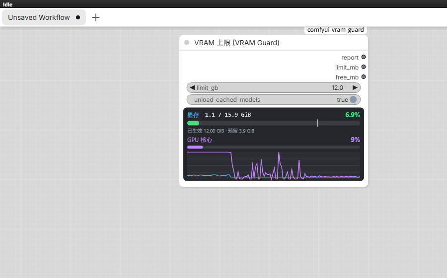

# ComfyUI VRAM Guard

给 ComfyUI 进程加一个**显存天花板**：默认 12 GiB，16 GB 显卡上给系统 / 游戏 / 视频留出约 4 GiB；同时在节点上实时显示显存与 GPU 利用率。



## 功能

- **提交前生效**：每次排队工作流时，在任何节点执行之前设置上限（此时模型还没加载），不需要改启动参数。
- **三层限制**：PyTorch 分配器硬上限 + comfy-aimdo（DynamicVRAM）显存预留 + `EXTRA_RESERVED_VRAM`，效果等价于启动参数 `--reserve-vram 4`。
- **实时面板**：显存 `已用 / 总量 GiB`、百分比、上限刻度，GPU 核心利用率，以及最近 120 秒的双曲线；每秒刷新，不运行工作流也会更新。
- **只读监视节点**：`VRAM Monitor` 只显示数字，不修改任何设置。
- **HTTP 接口**：`/vram_guard/status`、`/vram_guard/live`、`/vram_guard/apply`，可以脚本化查询/切换上限。

## 安装

```bash
cd <ComfyUI>/custom_nodes
git clone https://github.com/jamesjiang8280/comfyui-vram-guard.git
```

也可以直接把 `comfyui-vram-guard` 目录复制到 `<ComfyUI>/custom_nodes/` 下。

重启 ComfyUI，启动日志里应出现：

```
[VRAMGuard] pre-execution hook installed
[VRAMGuard] HTTP routes registered: /vram_guard/status
```

然后在浏览器里按 **Ctrl+F5** 强制刷新一次，加载新的前端扩展。

兼容性：ComfyUI 0.39+（0.40 上完整验证）；PyTorch 2.8+ / CUDA。Windows 上测试于 RTX 5060 Ti 16G + torch 2.12.1+cu130。没有 comfy-aimdo 的旧版本会自动退化为只有 PyTorch 硬上限。

## 使用

1. 在工作流里添加节点 **“VRAM 上限 (VRAM Guard)”**（分类 `VRAM`）。
2. `limit_gb` 填 **12**（表示 ComfyUI 最多用 12 GiB）。
3. 正常排队运行即可；节点不需要连到任何东西，它是输出节点，会自己执行。

提交工作流时，控制台会打印：

```
[VRAMGuard] limit=12.00 GiB (75.5%) reserve=3.90 GiB source=prompt
```

`source=prompt` 表示在第一个节点执行前就生效了（这是关键：模型还没加载）。

节点输出 `report` 可以接到 **Preview Any / Show Text** 查看文字报告，例如：

```
VRAM 上限已生效：12.00 GiB（为系统/游戏预留 3.90 GiB）
PyTorch 分配器上限：75.5%（fraction=0.7546）
设备：NVIDIA GeForce RTX 5060 Ti
全系统显存：已用 1.10 GiB / 共 15.90 GiB / 空闲 14.81 GiB
ComfyUI torch：已分配 0.00 GiB / 已预留 0.00 GiB
aimdo 记账：0.00 GiB / headroom 3.90 GiB
```

### 实时面板（数字 + 动态曲线）

节点下半部分自带一个每秒刷新的实时面板，**不需要运行工作流**：

- **显存**：`已用 / 总量 GiB` 与百分比（按整卡计算），进度条上的白色刻度是 `limit_gb` 的位置；
- **上限 / 预留**：当前**已生效**的显存上限，以及为系统/游戏预留的量；
- **GPU 核心**：通过 NVML 读取的整卡 GPU 利用率（包含游戏、浏览器等所有程序）；
- **动态曲线**：最近 120 秒的显存占用率（青色）与 GPU 核心利用率（紫色）。

拖动节点右下角把节点拉高，曲线区域会自动变大。数据来自 `GET /vram_guard/live`，前端每秒轮询一次。

注意：面板里的“已生效上限”是当前进程实际生效的值；拖动 `limit_gb` 控件本身不会立刻改上限，排队运行一次后才会更新（避免运行中改上限导致 OOM）。

如果面板一直显示“正在连接显存监视…”，先强制刷新浏览器（Ctrl+F5），并确认 `http://127.0.0.1:8188/vram_guard/live` 能打开。

### 取消限制

把 `limit_gb` 填成大于等于总显存的值（如 **16**），PyTorch 上限会恢复为 100%，aimdo 预留归零。

### 状态接口（可选）

```
GET  http://127.0.0.1:8188/vram_guard/status
GET  http://127.0.0.1:8188/vram_guard/live
POST http://127.0.0.1:8188/vram_guard/apply     {"limit_gb": 12}
```

`/vram_guard/live` 返回当前数值、`gpu_util` 和最近 120 秒的历史数组，面板就是用它绘制的。可以在不运行工作流的情况下查看/修改当前上限（端口按你的 ComfyUI 实际端口改）。

## 它做了什么

| 层 | 调用 | 效果 |
|---|---|---|
| PyTorch 分配器 | `torch.cuda.set_per_process_memory_fraction(limit/total)` | 进程内 torch 分配超过上限直接 OOM，不会继续吃显存 |
| comfy-aimdo（DynamicVRAM） | `set_simple_vram_headroom(total-limit)` | 让 DynamicVRAM 把多出来的模型页换出，优先保住“留给其他程序”的空间 |
| ComfyUI 旧估算路径 | `EXTRA_RESERVED_VRAM = total-limit` | 等价于启动参数 `--reserve-vram 4` 的效果 |

## 重要限制（请务必读）

1. **只限显存，不限算力。** 这个节点不会降低 GPU 核心占用率。ComfyUI 跑图时 GPU 仍可能接近 100%，游戏帧数仍然会掉；它保证的是“不会被 ComfyUI 挤爆显存 / 触发 Windows 共享显存卡顿”。
2. **12 GiB 是 ComfyUI 的预算，不是整卡读数。** CUDA 上下文、驱动等进程开销另算，`nvidia-smi` 里可能看到约 12.3–12.5 GB。想更严格就填 11.5。
3. **aimdo 的 headroom 是设备级保留。** 游戏已经占用 2 GB 时，ComfyUI 会更早让出显存，总占用不会顶满；这是有意的保守策略。
4. **上限过小会 OOM。** DynamicVRAM 会尽量换出，但激活值 / VAE 解码仍可能超过上限。遇到 OOM 就把 `limit_gb` 调大 0.5–1。
5. **仅 NVIDIA CUDA 有效。** CPU / MPS 只显示状态，不会设上限。
6. **改上限会清缓存。** 如果当前已缓存占用超过新上限，节点会先卸载缓存模型（`unload_cached_models=true`），下一次运行会重新加载，首次会慢一些。
7. 没有输入的工作流节点可能被 ComfyUI 缓存而跳过 `run()`，但**预执行钩子每次提交都会执行**，所以上限仍然每次生效（只是节点上的报告文字可能不刷新）。

## 验证

跑一个会吃显存的工作流，同时开一个 PowerShell：

```powershell
while ($true) { nvidia-smi --query-gpu=memory.used --format=csv,noheader; Start-Sleep -Seconds 1 }
```

在 12 GiB 上限下，ComfyUI 的占用应稳定在 12 GiB 附近而不是把 16 GB 吃满；游戏 / 浏览器仍能拿到约 4 GiB。
也可以直接看节点面板：显存百分比、GPU 核心利用率和 120 秒曲线都是每秒刷新的。
`GET /vram_guard/status` 里的 `state.fraction` 也能确认（12 GiB / 15.90 GiB ≈ 0.7546）。

## 卸载

删除 `custom_nodes/comfyui-vram-guard`，重启 ComfyUI 即可。限制是进程内的，重启后自然消失。

## English

A ComfyUI custom node that caps the process VRAM budget (default 12 GiB) **before any node of a prompt executes**, leaving the rest of the GPU for games or video playback. The node itself also renders a live panel with VRAM usage, GPU core utilisation (NVML) and a 120-second history graph.

```bash
cd ComfyUI/custom_nodes
git clone https://github.com/jamesjiang8280/comfyui-vram-guard.git
```

Restart ComfyUI, hard-refresh the browser (Ctrl+F5), then add **VRAM Guard** from the `VRAM` category.

The ceiling is enforced with `torch.cuda.set_per_process_memory_fraction()` plus comfy-aimdo's VRAM headroom (equivalent to `--reserve-vram 4`). It limits **VRAM, not compute** — the GPU can still be saturated while sampling, so a game may still lose FPS; the cap prevents ComfyUI from exhausting VRAM or spilling into Windows shared memory.

## License

MIT
